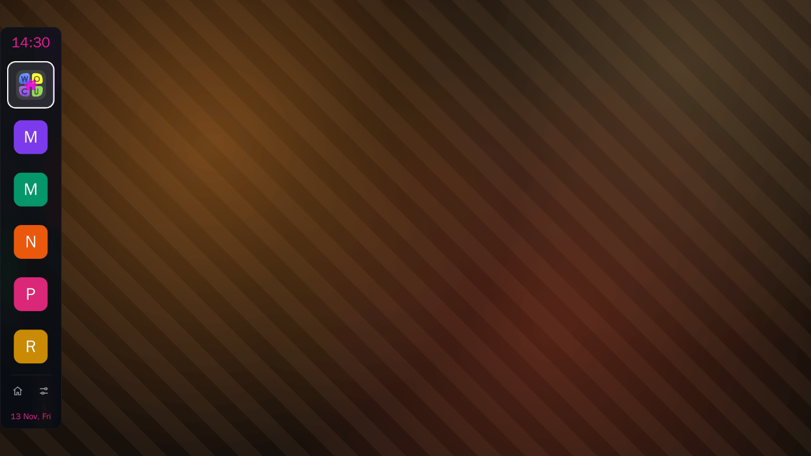

<h1 align="center">WebOCU Dock</h1>

<p align="center">
  An overlay app launcher for webOS TV: a small dock at the edge of the picture,
  driven by the TV remote.
</p>

<p align="center">
  <a href="LICENSE"></a>
  <a href="https://github.com/webocu/webocu-dock/actions/workflows/ci.yml"></a>
  <a href="https://github.com/webocu/webocu-dock/releases"></a>
  
</p>

<p align="center">
  
</p>

The dock holds the icons of the apps installed on the TV. Pick one with the remote and it
starts; the dock goes away and the picture stays. It is drawn over whatever is on the
screen without stopping video playback, so it can be called up at any moment.

The app list and the launch go through luna-service. The dock's own settings live in a
window of their own, opened from the button at the foot of the dock. Nothing in it
changes the TV's settings.

## Features

- **Dock over the picture.** At the left or right edge, with an offset from the edge and a
  vertical position you choose; it comes onto the screen with an entrance effect of your
  pick (or none).
- **Grid of apps.** 1 to 7 columns, 3 to 7 rows on screen; a longer list scrolls with the
  focus. Single apps can be switched off, and the TV's inputs can be added.
- **Quick buttons at the foot.** Up to four: webOS Home, webOS Settings, LG Store, Browser,
  Media Player, Home Dashboard, Eco mode, Sleep timer, Power Off, Restart (both behind a
  five-second countdown), Screen Off, or a **Submenu** of up to eight such items.
- **Names of the icons** as hints: when, where and how they look (five styles, four
  effects).
- **Clock and date** in the dock, in several formats and sizes.
- **Looks.** Dark, light and high-contrast themes, accent colours, background pictures,
  transparency.
- **Twelve languages:** Bulgarian, Chinese, Croatian, English, French, German, Polish,
  Portuguese, Russian, Serbian, Spanish, Ukrainian.
- **HOME button (rooted TVs).** The remote's HOME key can open the dock instead of the TV's
  launcher (Settings → Tweaks).
- **Magic Remote.** The pointer moves the focus and starts apps as the arrows and OK do.

## Using it

| Key | Dock | Settings window |
| --- | --- | --- |
| ▲ ▼ ◀ ▶ | move between the app icons and the buttons at the foot | rail / rows, values |
| OK | start the app; Home — the TV home screen; Settings — this window | open, change, confirm |
| Back | hide the dock | one level up; from the rail — back to the dock |
| Yellow / M | hide the app | hide the app |

The dock shows the apps the app manager reports as user apps (store and Developer Mode
installs), without the ones you switched off and without itself, sorted by name.

Settings window:

- **Applications** — which apps the dock shows, in what order; read the list again.
- **General** — language, clock and date, autostart, closing when inactive, which icon has
  the focus on open, reset to defaults.
- **Appearance** — theme and accent, background, dock geometry, hints, quick launch,
  notifications.
- **Tweaks** — root privileges for the helper service, switching the app ID, keep-alive,
  the HOME button, the application and window type.
- **About** — version, author, links.

## Requirements

- An LG TV running webOS with **Developer Mode** enabled, or a TV rooted with
  [webosbrew](https://webosbrew.org).
- To install the `.ipk` from a computer: the webOS TV CLI (`ares-install`), or the `make`
  targets below (Docker only).

On some firmware a Developer Mode app is not allowed to ask the application manager for the
list of apps. The dock then says so, and **Settings → Tweaks → Request privileges** asks
the Homebrew Channel for root for the helper service (needs a rooted TV).

## Install

### From the Homebrew Channel (rooted TV)

1. Open the Homebrew Channel, then **Settings → Add repository**.
2. Enter `https://webocu.github.io/`
3. Open **WebOCU Dock** in the list and press **Install**.

The repository is the catalog of the WebOCU apps
([webocu/webocu.github.io](https://github.com/webocu/webocu.github.io)); the package itself is the
`.ipk` of the release below, and the TV checks its hash.

### With the webOS CLI (Developer Mode or root)

Download `webocu.dock_<version>_all.ipk` from
[Releases](https://github.com/webocu/webocu-dock/releases), then:

```sh
ares-setup-device --add tv -i "host=<tv-ip>" -i "port=9922" -i "username=prisoner"   # Developer Mode TV
ares-novacom --device tv --getkey                                                    # passphrase from the Developer Mode app
ares-install --device tv webocu.dock_<version>_all.ipk
ares-launch  --device tv webocu.dock
```

Or build and install from the repository without installing anything but Docker:

```sh
make tv-add TV=192.168.1.50 NAME=tv     # Developer Mode must be on
make tv-key NAME=tv
make build                              # dist/webocu.dock_<version>_all.ipk
make deploy                             # install + launch
```

For a rooted TV (real sshd on port 22) use `make tv-add-root TV=<ip> NAME=<name>` instead; see
[CONTRIBUTING.md](CONTRIBUTING.md#installing-on-a-tv).

The dock installs under its own id, `webocu.dock`. It and
[WebOCU Settings](https://github.com/webocu/webocu-settings) (`webocu.settings`) are
independent apps: neither needs the other, and removing one leaves the other alone.

## Build from source

[Docker](https://docs.docker.com/get-docker/) is the only requirement: no local Node.js and
no webOS CLI, everything runs in containers through `make`.

```sh
make            # list the targets
make check      # lint + smoke test + .ipk
make build      # build the .ipk into dist/
make dev        # the app in a browser: http://localhost:8080
make shots      # 1920x1080 screenshots into test/shots/
```

Every behaviour can be opened from a URL query string (for example
`http://localhost:8080/?cols=3&rows=5&section=look`), so the dock can be developed and
checked in a browser without a TV. The list of parameters is at the end of
[`source/js/app.js`](source/js/app.js).

## Project layout

| Path | What is there |
| --- | --- |
| `source/` | the app: plain ES5 browser JS, no build step, no framework, no npm dependencies |
| `source/service/` | the helper service (Node, ES5) |
| `source/locales/` | one translation file per language |
| `tools/` | the Docker-based toolchain: lint, smoke test, packaging, TV install |
| `misc/` | README assets |
| `dist/` | built packages (not in git) |

## Documentation

- [START_FLOW.md](START_FLOW.md) — startup sequence, the helper service and its endpoints.
- [STORAGE_ARCHITECTURE.md](STORAGE_ARCHITECTURE.md) — what the app stores and where.
- [CONTRIBUTING.md](CONTRIBUTING.md) — development workflow, conventions, `make` reference.
- [CODE_OF_CONDUCT.md](CODE_OF_CONDUCT.md) — how we treat each other in issues and pull requests.
- [CHANGELOG.md](CHANGELOG.md) — what changed in each release.
- [SECURITY.md](SECURITY.md) — how to report a vulnerability.

## Credits and third-party software

The HOME-button feature adapts [Hearth](https://github.com/rudra-avatar/Hearth) (MIT) and
ships the input hook library and injector of the **Input Hook** app, as that app does. The
package therefore contains components under other licenses than MIT, among them a
**GPL-3.0** library. One icon is taken from [Lucide](https://lucide.dev) (ISC). The full
list, with licenses and where each text lives, is in
[THIRD_PARTY_NOTICES.md](THIRD_PARTY_NOTICES.md).

## License

The code of WebOCU Dock is released under the [MIT License](LICENSE). Bundled third-party
components keep their own licenses, see [THIRD_PARTY_NOTICES.md](THIRD_PARTY_NOTICES.md).

WebOCU Dock is not affiliated with or endorsed by LG Electronics. webOS is a trademark of
LG Electronics. Root-level features run on a TV you have rooted yourself and are used at
your own risk.
